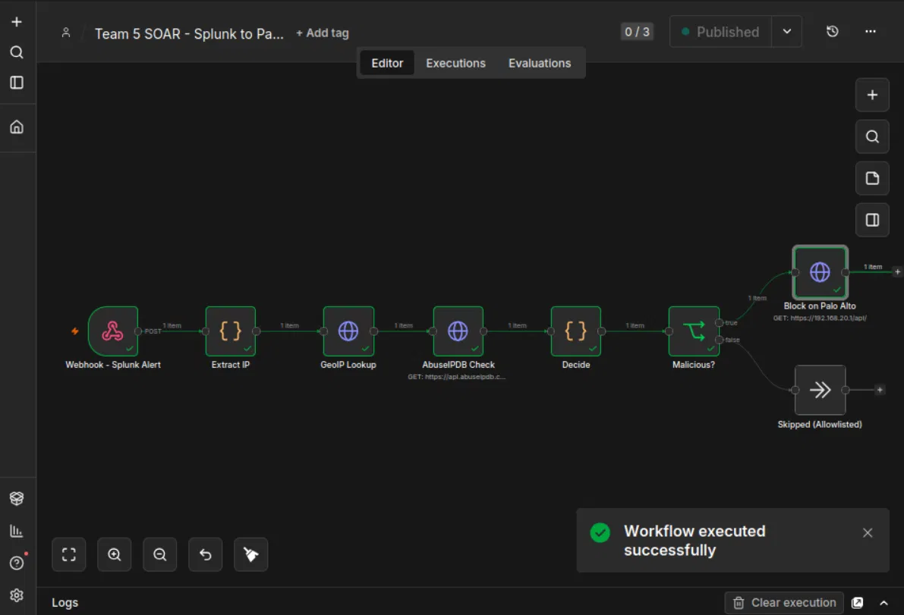
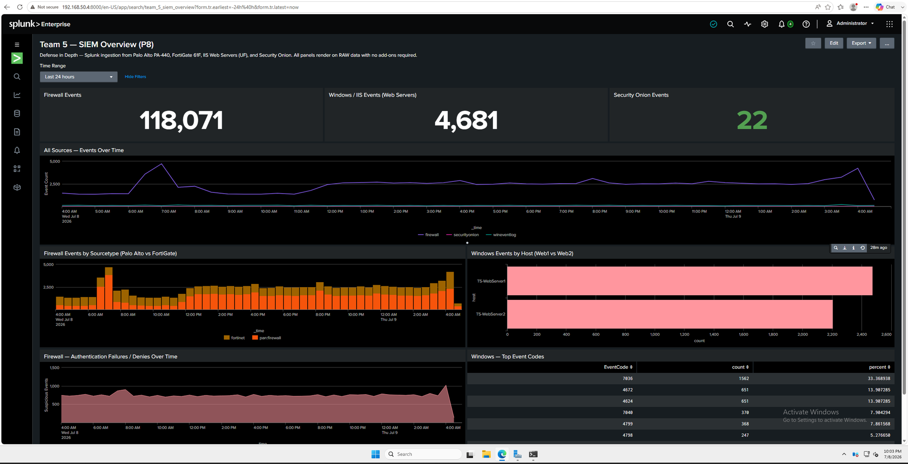

# Defense in Depth: Multi-Zone Enterprise Security Lab with SIEM & SOAR Auto-Block

A dual-vendor, six-zone enterprise network built on Proxmox VE. It layers a perimeter firewall, an
internal firewall, MFA-gated VPN, a clientless zero-trust gateway and a SIEM. On top of that sits an
automated detection-to-containment pipeline: it enriches a Splunk alert and blocks the source IP on a
Palo Alto firewall through its XML API, with no human step and no config commit.

> BYU-Idaho CIT 470 capstone, team of 3. See **My role** for exact attribution.
>
> **Status: archived.** The lab ran on university Proxmox infrastructure that was decommissioned after
> the course. Configs, SPL and the n8n workflow are in this repo. Proof that it ran is in
> **[32 redacted screenshots](docs/evidence/README.md)** captured from the live environment in July 2026.


## Architecture at a glance
| Layer | Control |
|---|---|
| Perimeter | Palo Alto PA-440: zone policy, NAT, GlobalProtect SSL VPN |
| Internal segmentation | FortiGate 61F isolates Inside (identity) and Secure (AD, SIEM, IDS) |
| Identity & MFA | Active Directory + Duo Authentication Proxy (RADIUS) for both the VPN and Guacamole |
| Zero-trust access | Apache Guacamole: per-user RDP/SSH sessions over HTTPS, no network-level access |
| Detection | Splunk Enterprise (5 sources, 8-panel dashboard), Security Onion (Zeek/Suricata) |
| Response | n8n SOAR: Splunk alert → GeoIP → AbuseIPDB → allowlist decision → Palo Alto dynamic block |

Details: [docs/architecture.md](docs/architecture.md)

## SOAR pipeline


```
Splunk alert ─► Webhook ─► Extract IP ─► GeoIP (ip-api) ─► AbuseIPDB ─► Decide ─► Malicious?
                                                                           ├─ true  ► PAN-OS user-id register (tag n8n-block → dynamic group → deny rule)
                                                                           └─ false ► Skipped (allowlisted infrastructure)
```
- **Decision logic is deterministic, not ML.** Any source that triggered a detection gets blocked
  unless it's on an explicit 11-IP infrastructure allowlist. GeoIP and AbuseIPDB results are recorded
  as context, but they don't gate the block. Your own IDS verdict outranks a third-party feed. In
  testing, an IP that AbuseIPDB scored 0 was still blocked. (That node-output screenshot wasn't preserved.)
- **The allowlist is the safety rail.** It lists the firewalls, AD, Splunk, Security Onion, the Duo proxy,
  both web servers, the load balancer and the n8n host. The automation can't take down its own infrastructure.
- **Blast-radius control:** the API runs under a dedicated API-only admin with a scoped role. It is
  exposed on one dataplane interface, to one host. The key travels in an `X-PAN-KEY` header, not the
  URL. Blocks land in a tag-driven dynamic address group, so no commit is needed.
- Workflow: [n8n/team5_soar_workflow.json](n8n/team5_soar_workflow.json) · Palo Alto setup: [paloalto/soar-api-setup.md](paloalto/soar-api-setup.md)

## SIEM


- Sources: Palo Alto (syslog UDP 5514), FortiGate (syslog UDP 5515), Web1/Web2 Windows event logs
  (Universal Forwarder, TCP 9997), and Security Onion Zeek logs (Linux UF, `_json`).
- Measured over 24 h (Jul 8–9 2026): **118,071** firewall events, **4,681** Windows events, **22** Security Onion events.
- Dashboard XML and every SPL query: [splunk/](splunk/)

## Validation
| Test | Result | Evidence |
|---|---|---|
| PAN-OS register API by hand, before automation | `status="success"` | [soar/04](docs/evidence/soar/04-pa-manual-register-proof.png) |
| End-to-end run on a simulated Splunk alert | All 8 nodes succeeded; PAN-OS `status="success"` | [soar/09](docs/evidence/soar/09-n8n-run-all-green.png), [soar/10](docs/evidence/soar/10-pa-register-success.png) |
| Block reached the firewall | Test IPs registered in `n8n-blocklist` | [soar/11](docs/evidence/soar/11-pa-blocklist-populated.png) |
| MFA on the zero-trust gateway | Login → Duo push → only the 4 published sessions appear | [access/02](docs/evidence/access/02-duo-push-radius.png), [access/06](docs/evidence/access/06-guacamole-published-sessions.png) |
| VPN segmentation | DMZ reachable; AD, FortiGate and Palo Alto mgmt time out | [segmentation/03](docs/evidence/segmentation/03-vpn-segmentation-tests.png) |
| Least exposure for AD | DMZ → AD allowed on LDAP only, on both firewalls | [segmentation/01](docs/evidence/segmentation/01-fortigate-dmz-to-ad-ldap.png), [segmentation/02](docs/evidence/segmentation/02-pa-allow-dmz-to-ad-tcp389.png) |
| SIEM ingestion | 5 sources live in one dashboard | [siem/01](docs/evidence/siem/01-splunk-siem-overview-dashboard.png) |
| AD provisioning automation | Scheduled run created the new CSV user; `LastTaskResult 0` | [ad/README.md](ad/README.md) |

## Known limitations
- The live Splunk → n8n trigger was designed (saved search, webhook alert action, dedicated firewall rule)
  but not captured end to end. Pipeline validation used a simulated Splunk payload sent with curl.
- No screenshot shows the allowlisted (Skipped) branch firing. The logic is visible in the Decide node.
- Firewall logs are raw syslog with no vendor add-on, so detections use `rex` field extraction.
- Suricata detections live in Security Onion's Elasticsearch, not in Splunk.
- Blocks don't expire. The next step would be a PAN-OS registered-tag `timeout`.
- Response time was never measured, so this repo claims no MTTR number. Method: compare the Splunk
  `alert_fired` time with the n8n execution end time over N runs, against a manual baseline.

## Security review of my own pipeline
Known weaknesses in the SOAR workflow, found in a post-course review and ordered by impact. None are fixed in this
archived version.

| # | Weakness | Impact | Fix |
|---|---|---|---|
| 1 | The n8n webhook accepts unauthenticated POSTs | Anything that can reach port 5678 can send a fake alert and get any non-allowlisted IP blocked, turning the automation into a denial-of-service tool | Header authentication on the webhook node, plus a firewall rule that allows only the Splunk host |
| 2 | TLS verification to the PAN-OS API is off (`allowUnauthorizedCerts: true`) | A machine in the path could impersonate the firewall and capture the API key | Trust the firewall's certificate and remove the flag |
| 3 | The source IP is inserted into the PAN-OS XML command without validation | If the IP ever comes from an attacker-influenced field (for example X-Forwarded-For in web logs), the XML can be injected | Validate strict IPv4/IPv6 format before building the command |
| 4 | The `_raw` regex fallback accepts invalid addresses (`999.999.999.999`), misses IPv6, and on Palo Alto syslog returns the firewall's own IP first | The fallback never blocks the real source on PA logs (it fails safe because the firewall is allowlisted) | Parse the source field by position or use the vendor add-on |

## My role
**Lead:** Palo Alto policy, NAT and GlobalProtect; AD accounts and least-exposure rules; Splunk deployment,
all ingestion and the dashboard; the full SOAR pipeline (PA API plumbing, n8n host, workflow); Guacamole
Docker/RADIUS/Duo integration.
**Support/testing:** teammates led HAProxy, Security Onion (deployment and detection rules) and the Duo proxy
install. My Security Onion work was forwarding its Zeek logs into Splunk.

## Lessons learned
[docs/lessons-learned.md](docs/lessons-learned.md) covers:
- a management-plane lockout recovered over serial console
- silent interzone drops and syslog service routes
- RADIUS direction and an MFA bypass I found and closed
- plaintext passwords in provisioning input
- what a secret review of the archived screenshots turned up

---
Secrets are redacted. Public IPs, hostnames, email addresses and other people's names are masked in
every image.
