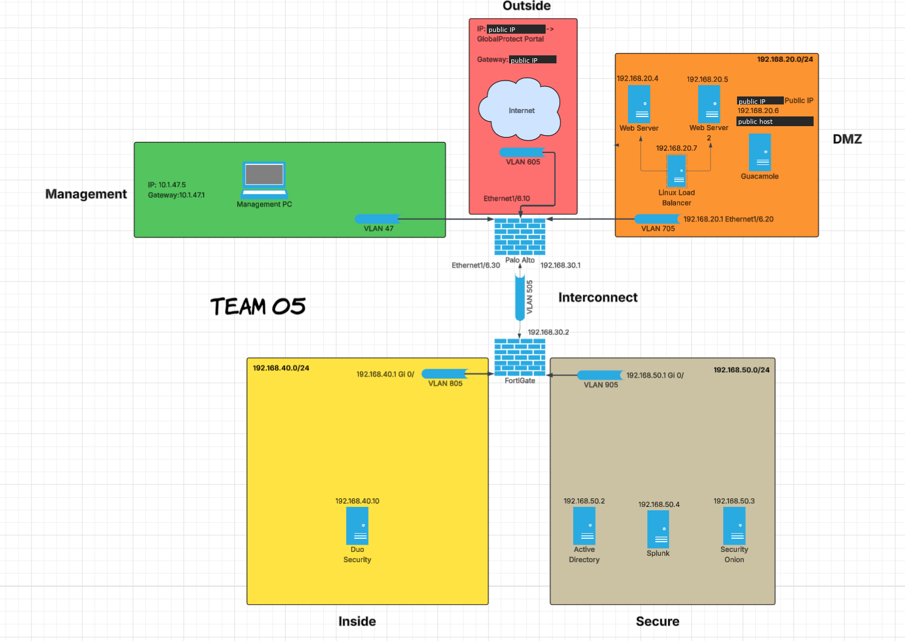

# Architecture & Topology

## Zones

| Zone | VLAN | Subnet / Key IPs | Enforced by | Purpose |
|---|---|---|---|---|
| Outside | 605 | Public /29 → GlobalProtect portal + Guacamole | Palo Alto eth1/6.10 | Internet edge |
| DMZ | 705 | 192.168.20.0/24 (GW .20.1, eth1/6.20) | Palo Alto | Public-facing services |
| Management | 47 | 10.1.47.0/24 (PA mgmt 10.1.47.5) | Out-of-band | Device administration only |
| Interconnect | 505 | 192.168.30.0/30 (PA .30.1 ↔ FortiGate .30.2) | Transit | Separates the two firewall tiers |
| Inside | 805 | 192.168.40.0/24 (GW .40.1) | FortiGate | Identity/MFA services |
| Secure | 905 | 192.168.50.0/24 (GW .50.1) | FortiGate | Crown jewels: AD, SIEM, IDS |

Note: from the Palo Alto's point of view, Inside and Secure sit behind the Interconnect zone.
PA rules to 192.168.40.10 or 192.168.50.4 therefore use destination zone **Interconnect**.

## Hosts

| Host | IP | Zone |
|---|---|---|
| Web Server 1 / 2 (IIS) | 192.168.20.4 / .20.5 | DMZ |
| HAProxy load balancer (Linux) | 192.168.20.7 | DMZ |
| Guacamole + n8n (Docker host) | 192.168.20.6 | DMZ |
| Duo Authentication Proxy | 192.168.40.10 | Inside |
| Active Directory (t5.org) | 192.168.50.2 | Secure |
| Security Onion | 192.168.50.3 | Secure |
| Splunk Enterprise | 192.168.50.4 | Secure |

## Two-vendor firewall design
- **Palo Alto PA-440 (perimeter):** Outside/DMZ/Interconnect policy, NAT, GlobalProtect,
  syslog to Splunk, SOAR enforcement point (`SOAR-Auto-Block` + dynamic group `n8n-blocklist`).
- **FortiGate 61F (internal):** segments Inside and Secure from everything above.
  An attacker who compromises a DMZ host still has to get through a second firewall from a
  different vendor, with a different rule base.
- **Least-exposure example:** DMZ can reach AD only on TCP 389 (LDAP), enforced on BOTH firewalls.

## Remote access paths
- **GlobalProtect (SSL VPN):** RADIUS auth → Duo proxy → AD + Duo push. Pool 192.168.60.0/24,
  split tunnel to internal routes. This is admin/network-level access.
- **Apache Guacamole (clientless ZTNA):** HTTPS via destination NAT. Duo MFA over RADIUS.
  Per-user access to exactly four published sessions (no network-level access).
  This is the zero-trust path: users reach specific applications, not subnets.
